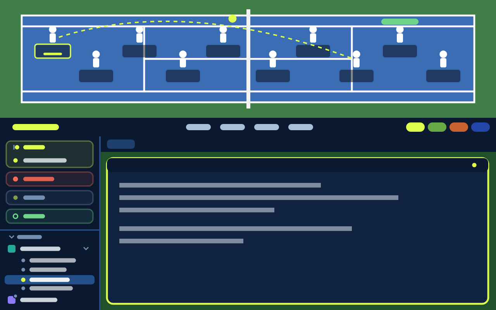

# Tennis

A tennis court for your coding agents. Every agent is a player on a top-down court; agents at work rally a ball over the net, agents that need you jump and call a challenge, and finished ones show "GAME". A scoreboard counts each status and switches between four courts: hard, grass, clay and indoor. Your spaces, tabs and terminals sit underneath in the court's colors.

## What you see

Top to bottom:

1. **Court**, 230px tall (drag between 140 and 420px). A surround (`#3f7f47` on hard) with a court inside it, inset `max(60px, 4%)` from the left and `max(34px, 16%)` top and bottom, ending 40px before the bench area on the right. White 2px lines: doubles box, singles sidelines 12.5% of the court height in from each side, service lines 23% of the court width either side of the net, the center service line and baseline center marks. The net is a vertical 4px `#f2f2f2` bar with a 6px `#00000030` shadow to its right and 10px `#2a2a2a` posts above and below. Top left, at least 90px in to clear the window buttons: a 10px ball-yellow dot, the court name (14px, 800) and the active space's name (13px, `#ffffffb0`). Above the court's right end: the umpire's call (13px, 700).
   **Bench**, on the right: `clamp(15% of the width, 170px, 240px)` wide, 24px from the window edge, on a `#00000026` panel with 10px corners. Header "BENCH" (12px, 800) and how many sit there. Up to three wooden benches stacked 78px apart, as many as fit the height: a 7px `#7a5130` backrest, a 7px `#b07a45` seat and 4px `#7a5130` legs. Each seat is 48px wide and holds a 40 x 52px seated player in whites with a green towel, an 8px status dot at its top right and its space name under it (9px, 600, white, truncated).
2. **Scoreboard**, 38px, `chrome` background. Left: "SCOREBOARD" (10px, 800, `accent`) and `space / tab` (13px, 600). Center: four cells, RALLY, CHALLENGE, GAME and READY, each a 10px label in `muted` and a 15px count in the status color (`dim` when 0), split by 1px x 18px `border` dividers. Right: four court chips (Hard, Grass, Clay, Indoor), each an 8px swatch of that court plus its name; the shown court's chip is `accent` with `accent_foreground` text.
3. **Work area**: a 220px spaces sidebar (`tennis-spaces`) beside a 30px tab bar (the shipped `tabs` mod) over the active tab. The sidebar is Herdr's spaces list plus agent status: a space with an agent working, blocked or done gets a 3px bar on its left edge (ball-yellow for working, `blocked`, `done`) and a 16px second line under its name, indented to line up with the name. That line shows, in this order, a "CHALLENGE" pill in `blocked` (pulsing, opacity 0.6 to 1, 700ms), a "GAME" pill in `done` (9.5px, 800, `#10140c` text), and a 7px ball bouncing 3px (560ms) beside "Rally" in `working` (10.5px, 700). A count follows each word when more than one agent has that status ("Rally 2"). Spaces whose agents are all idle stay one line. Panes are cards: 8px gap, 6px radius, 2px `border` border, 2px `accent` when focused, framed even when alone. Each pane has a 26px header: program icon (15px), program name (600), `on <branch>` in `dim`, and on the right a status dot and word.

Courts (layout surface colors, then theme `background` / `accent`):

| Court | Court | Stripe | Surround | Lines | Theme background | Accent |
|---|---|---|---|---|---|---|
| Hard | `#3a6db3` | none | `#3f7f47` | `#ffffff` | `#0f2340` | `#dfff4f` |
| Grass | `#5c9a3c` | `#69a847` | `#4a7f30` | `#fbfbf3` | `#10241a` | `#c39bf0` |
| Clay | `#c8632f` | none | `#a8512a` | `#fff7ee` | `#2a140c` | `#4fbf7f` |
| Indoor | `#2346a8` | none | `#141826` | `#ffffff` | `#0f1018` | `#4fd1ff` |

Grass is mown: 12 vertical bands alternating court and stripe colors.

Players are 46 x 57px figures in tennis whites holding a racket, facing the net. Under each: a dark `#00000066` pill with the program icon (12px), the agent's space name (11px, 600, white, truncated) and its status word in the status color. The focused agent's pill has a 1px ball-yellow border.

## How it behaves

- Agents alternate sides: first left, second right, and so on. Blocked agents get places first, then working, done, idle and unknown, so busy agents are never hidden. Each side has room for `floor((courtWidth / 2 - 5% - 30) / 132)` players, set 132px apart from the baseline toward the net and zigzagging 17% of the court height above and below the center line. The rest sit on the bench in the same order, filling each bench left to right; their dot pulses (opacity 0.4 to 1, 800ms) while working or blocked. When the benches are full, "+N more" shows at the bench area's bottom right. Clicking a seated player focuses that agent.
- **working (Rally):** the player bounces 5px (560ms). While any agent works, a 12px ball (`#dfff4f`, `#a8c225` edge) rallies between the first working player on each side, racket to racket, in 1800ms, arcing 28px up mid-flight, with a 12 x 5px `#00000044` shadow on the ground. With working players on one side only, the ball goes to the opposite baseline center and back. Umpire: "Quiet please, rally in progress".
- **blocked (Challenge):** the player jumps 16px (760ms) under a "CHALLENGE" badge in the `blocked` color that pulses (opacity 0.6 to 1, 700ms). The umpire call reads "Challenge! N agent(s) need you" in `blocked` and pulses too.
- **done (Game):** a "GAME" badge in the `done` color. Umpire: "Game! Check the results".
- **idle (Ready) / unknown (Warm-up):** an 8px ball bounces at the player's feet (900ms). Umpire: "Players ready".
- No agents: "No players on court yet. Start an agent to serve." across the court.
- Clicking a player runs `agent.focus` for it. The court strip drags the window.
- Clicking a court chip runs `app.theme` with that court's theme; the court drawing, scoreboard, sidebar and terminals all switch together. Picking a tennis theme in Settings does the same.
- A pane header's working dot is ball-yellow and pulses (opacity 0.35 to 1, 800ms).
- Players slide to new spots (`top` transition, 500ms) when the line-up changes.

## Built from

- `layouts/tennis.json`: a root column with `titlebar: "none"`, `traffic_lights: [16, 18]`, `theme: "tennis-hard"`, `font_size: 13`, `ui_font: "Geist"`, `background: "canvas"`, `terminal_padding: [8, 10]` and `preview: "layouts/tennis.svg"`. Children: `tennis-court` (block, mod `tennis`, `window_drag`), `tennis-scoreboard` (block, mod `tennis` with props `{ "role": "scoreboard" }`), then a row of `sidebar` (column holding `tennis-spaces`) and `tennis-work` (column: shipped `tabs` mod, then the `{ "tab": "active" }` block with the pane frame above and a header of mod `tennis` with props `{ "role": "pane" }`).
- `mods/tennis/main.js`: one `View` with three roles. No role draws the court; `scoreboard` draws the bar; `pane` draws a pane header. It uses `agents()`, `spaces()`, `panes()`, `props()`, `settings()`, `theme()`, `setAgentOrder()` and `run()` with `agent.focus` and `app.theme`. It runs no programs, makes no network calls and reads no files.
- `mods/tennis-spaces/`: made with `herdr-app do mod.clone --name spaces --as tennis-spaces` (spaces 0.1.12), then changed in three places: `tally()` counts each space's working, blocked and done agents from `agents()` once per render; `row()` adds the left bar and grows the row by 16px when there is a status; `statusLine()` draws the second line. Everything else (worktree nesting, git branch and ahead/behind, drag to reorder, right-click menu, machines) is Herdr's.
- The court is drawn from absolutely positioned `div`s sized from `on_size_change`, so it fills any window width.
- Art: `mods/tennis/player-facing-right.svg` (left-side players), `player-facing-left.svg` (right-side players, the same drawing mirrored) and `player-sitting.svg` (bench players, front view). The benches are `div`s.
- `themes/tennis-hard.json`, `tennis-grass.json`, `tennis-clay.json`, `tennis-indoor.json`: dark terminal themes in each court's colors. `working`, `blocked` (`#ff6b57`), `done` and `idle` are set per theme.

## Watch out

- `loop()` animates one property per element, so the rallying ball is three nested `div`s: an outer one looping `top` between the two rackets, a child looping `left`, and the ball itself looping `top` for the arc at half the period. All three use `linear` easing except the arc (`ease-out`); keep the periods equal or the ball leaves its path.
- `on_size_change` reports the block's size before the person's zoom, but `left`, `w` and the other sizes are scaled by it. Divide the reported size by `settings().zoom`, or at zoom 0.9 the court comes out 10% narrow with a gap on the right.
- The court reads which court to draw from `settings().theme`. Any theme that isn't one of the four tennis themes draws the hard court.
- The court block has `window_drag`, so each player stops the left mouse-down from propagating, otherwise clicks drag the window.
- Tab names are often just numbers, so player labels use the space name.
- Put the sidebar status on its own line. On the name's line it squeezes the name and git details and cuts long space names.
- The sidebar is a copy of Apache-2.0 Herdr code: keep the notice at the top of `tennis-spaces/main.js` that says where it came from and that it was changed.
- The court shows agents from every space, not only the active one.
- Theme picks are stored per layout in `layouts/.state/`, so a court chosen here stays on this layout only.

## Done when

- `herdr-app check mods/tennis` passes and `herdr-app status` shows no errors with the layout shown.
- With two agents working, they stand on opposite baselines labelled "Rally" and a ball flies between their rackets with its shadow on the court.
- An agent waiting for approval jumps under a pulsing "CHALLENGE" badge and the umpire call turns red.
- Clicking Grass, Clay and Indoor on the scoreboard recolors the court, the scoreboard, the sidebar and the terminals; Grass shows mown stripes.
- Clicking a player focuses that agent's terminal.
- A space with a working agent shows a ball-yellow bar and "Rally" under its full, uncut name in the sidebar; one waiting for approval shows a pulsing "CHALLENGE" pill there.
- More agents than fit on court sit on the bench with their space names, every working agent is on court, and at zoom 0.9 the court and bench reach the window's right side with no empty gap.
